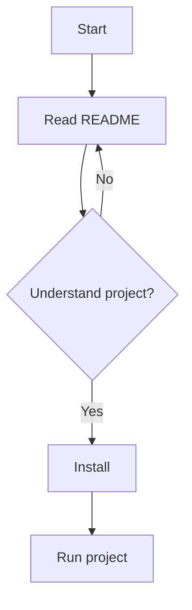
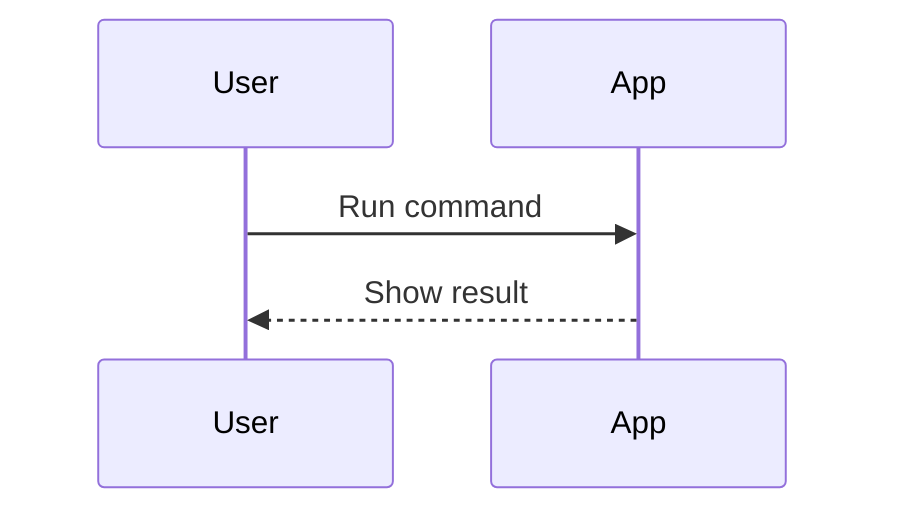

# README.md and Markdown: Complete Formatting Guide

A practical reference for writing README files, especially for GitHub
projects and personal learning repositories.

-   **README** explains what a project is, how to set it up, and how to
    use it.
-   **Markdown** is a lightweight markup language written as plain text.
-   **`.md`** is the common file extension for Markdown documents.

> Markdown rendering varies by platform. GitHub supports several
> extensions that some Markdown viewers do not. This guide labels
> GitHub-specific features where appropriate.

------------------------------------------------------------------------

# 1. A Typical README Layout

``` markdown
# Project Name

One or two sentences explaining what the project does and who it is for.

## Features

- Feature one
- Feature two
- Feature three

## Requirements

List software, versions, or tools needed.

## Installation

Explain how to install or set up the project.

## Usage

Show how to run or use it.

## Examples

Provide examples and expected results.

## Project Structure

Explain important files and folders.

## Contributing

Explain how others can contribute.

## License

State the project's license.
```

You do not need every section. A small exercise may need only a title,
description, and example. A library or application may need
installation, usage, configuration, testing, contribution, and license
details.

------------------------------------------------------------------------

# 2. Headings

Use `#` symbols at the start of a line.

``` markdown
# Heading 1
## Heading 2
### Heading 3
#### Heading 4
##### Heading 5
###### Heading 6
```

Rendered result:

# Heading 1

## Heading 2

### Heading 3

#### Heading 4

##### Heading 5

###### Heading 6

The number of `#` symbols determines the heading level. Use one `#` for
the document title, then use levels in a logical hierarchy. Do not
choose heading levels only because of their visual size.

## Alternative heading syntax

``` markdown
Heading 1
=========

Heading 2
---------
```

This alternative supports only level-one and level-two headings and is
less commonly used in modern README files.

------------------------------------------------------------------------

# 3. Paragraphs and Line Breaks

A blank line separates paragraphs.

``` markdown
This is the first paragraph.

This is the second paragraph.
```

To force a line break inside a paragraph, Markdown commonly supports
either two trailing spaces or an explicit line break:

``` markdown
First line.  
Second line.
```

The two trailing spaces can be difficult to notice. For most writing,
separate paragraphs with a blank line instead.

------------------------------------------------------------------------

# 4. Text Formatting

  Purpose           Markdown                 Result
  ----------------- ------------------------ ----------------------
  Bold              `**important**`          **important**
  Italic            `*emphasis*`             *emphasis*
  Bold and italic   `***very important***`   ***very important***
  Strikethrough     `~~removed text~~`       ~~removed text~~
  Inline code       `` `ls -la` ``           `ls -la`

Examples:

``` markdown
This is **bold text**.
This is *italic text*.
This is ***bold and italic***.
This is ~~outdated information~~.
Run `pwd` to print the current directory.
```

Use inline code for command names, filenames, paths, variables, and
short code expressions.

## Escaping Markdown symbols

Put a backslash before a Markdown symbol when you want it to appear
literally.

``` markdown
\*This is not italic text\*
\# This is not a heading
```

Rendered result:

\*This is not italic text\*

\# This is not a heading

------------------------------------------------------------------------

# 5. Lists

## 5.1 Unordered lists

Use `-`, `*`, or `+`. Choose one style and keep it consistent.

``` markdown
- HTML
- CSS
- JavaScript
```

Rendered result:

-   HTML
-   CSS
-   JavaScript

## 5.2 Ordered lists

``` markdown
1. Install the tools.
2. Download the project.
3. Run the program.
```

Rendered result:

1.  Install the tools.
2.  Download the project.
3.  Run the program.

Markdown renderers commonly calculate numbering automatically, but
writing sequential numbers is easier to maintain.

## 5.3 Nested lists

Indent nested items consistently.

``` markdown
- Frontend
  - HTML
  - CSS
  - JavaScript
- Backend
  - Node.js
  - Database
```

Rendered result:

-   Frontend
    -   HTML
    -   CSS
    -   JavaScript
-   Backend
    -   Node.js
    -   Database

## 5.4 Lists containing paragraphs

``` markdown
1. **Install dependencies**

   Install the packages required by the project.

2. **Run the application**

   Start the development server.
```

Keep the paragraph indented under its list item.

------------------------------------------------------------------------

# 6. Links

## 6.1 Standard link

Syntax:

``` markdown
[Link text](https://example.com)
```

Example:

``` markdown
[GitHub](https://github.com)
```

Result: [GitHub](https://github.com)

## 6.2 Link with a title tooltip

``` markdown
[GitHub](https://github.com "Visit GitHub")
```

The title may appear when a reader hovers over the link, depending on
the viewer.

## 6.3 Link to another file

``` markdown
[Installation guide](docs/installation.md)
```

Use a relative path when linking to a file in the same repository.

## 6.4 Link to a heading

``` markdown
[Jump to Installation](#installation)
```

On GitHub, a heading such as `## Installation` usually creates the
anchor `#installation`. Automatic anchor rules can vary for punctuation
and duplicate headings.

## 6.5 Reference-style links

Useful when the same URL appears several times.

``` markdown
Read the [official documentation][docs].

You can also check the [documentation][docs] later.

[docs]: https://example.com/docs "Official documentation"
```

## 6.6 Automatic links

Many Markdown renderers automatically link URLs:

``` markdown
https://github.com
```

For explicit email links:

``` markdown
[Contact](mailto:hello@example.com)
```

------------------------------------------------------------------------

# 7. Images

## 7.1 Basic image

Syntax:

``` markdown

```

The description is alternative text. It helps screen-reader users and
appears if the image cannot load.

## 7.2 Image with a title

``` markdown

```

## 7.3 Image from a URL

``` markdown

```

## 7.4 Clickable image

``` markdown
[](https://example.com)
```

## 7.5 Image sizing

Standard Markdown does not define a universal image-width syntax. On
GitHub, HTML can be used in many README contexts:

``` html

```

Use a relative image path for images stored in your repository. Keep
screenshots and diagrams in a clear folder such as `docs/images/` or
`assets/`.

------------------------------------------------------------------------

# 8. Code

## 8.1 Inline code

Use single backticks around a short command, variable, or code
expression.

``` markdown
Run `npm install` to install dependencies.
```

Result: Run `npm install` to install dependencies.

## 8.2 Fenced code blocks

Use three backticks before and after a block.

```` markdown
```text
Hello, world!
```
````

Result:

``` text
Hello, world!
```

## 8.3 Syntax highlighting

Write the language name after the opening backticks.

```` markdown
```python
def greet(name):
    print(f"Hello, {name}!")

greet("Learner")
```
````

Rendered code:

``` python
def greet(name):
    print(f"Hello, {name}!")

greet("Learner")
```

Common language labels include `bash`, `sh`, `zsh`, `python`,
`javascript`, `typescript`, `html`, `css`, `json`, `yaml`, `sql`, `c`,
`cpp`, `java`, `text`, and `diff`.

## 8.4 Shell commands

``` bash
pwd
mkdir -p practice/files
cd practice/files
touch notes.txt
ls -la
```

Use `bash` or `sh` for shell commands. Do not include a real shell
prompt such as `$` unless it is useful to the example; readers may
accidentally copy it.

## 8.5 Show command output

```` markdown
Command:

```bash
pwd
```

Example output:

```text
/home/learner
```
````

Label output separately from commands. Actual output depends on the
user's system.

## 8.6 Code blocks containing backticks

Use four or more backticks around the outside when the code example
itself contains triple backticks.

``` markdown
```

Example:

``` bash
pwd
```

## 8.7 Diff blocks

``` diff
- old_name = "Old"
+ new_name = "New"
```

A `diff` block can highlight added and removed lines. Color presentation
depends on the renderer.

------------------------------------------------------------------------

# 9. Blockquotes

Use `>` at the start of a line.

``` markdown
> This is a quotation or a note.
```

Result:

> This is a quotation or a note.

Nested blockquotes:

``` markdown
> First level
>
> > Second level
```

Result:

> First level
>
> > Second level

Use blockquotes for short notes, cautions, quotations, or context.
GitHub also supports special alert syntax described later in this guide.

------------------------------------------------------------------------

# 10. Horizontal Rules

Use three or more hyphens, asterisks, or underscores on a line by
themselves.

``` markdown
---
```

Result:

------------------------------------------------------------------------

Use horizontal rules to separate major parts of a document, not after
every paragraph.

------------------------------------------------------------------------

# 11. Tables

Use pipes `|` to separate columns and hyphens `-` to define the header
separator.

``` markdown
| Command | Purpose |
|---|---|
| `pwd` | Show current directory |
| `ls` | List directory entries |
| `cd ..` | Move to parent directory |
```

Rendered result:

| Command | Purpose |
|---------|---------|
| `pwd` | Show current directory |
| `ls` | List directory entries |
| `cd ..` | Move to parent directory |

## 11.1 Align table columns

``` markdown
| Left | Center | Right |
|:---|:---:|---:|
| Text | Text | 123 |
| More | More | 456 |
```

Rendered result:

| Left | Center | Right |
|:---|:---:|---:|
| Text | Text | 123 |
| More | More | 456 |

Tables are good for options, comparisons, requirements, and command
references. Very long text is often easier to read as a list instead.

------------------------------------------------------------------------

# 12. Task Lists / Checkboxes

Task lists are supported by GitHub Flavored Markdown (GFM) and some
other renderers.

``` markdown
- [x] Create the repository
- [x] Add a README
- [ ] Write installation instructions
- [ ] Add screenshots
```

Rendered result:

-   [x] Create the repository
-   [x] Add a README
-   [ ] Write installation instructions
-   [ ] Add screenshots

Use `x` for completed tasks and a space for incomplete tasks.

------------------------------------------------------------------------

# 13. HTML Inside Markdown

Many Markdown renderers allow some HTML.

## 13.1 Line break and divider

``` html
First line<br>
Second line

<hr>
```

Prefer normal Markdown where it works. HTML support and sanitization
differ between platforms.

## 13.2 Details / Collapsible Section

Commonly supported on GitHub:

````html
<details>
  <summary>Show installation details</summary>

  Run these commands:

  ```bash
  sudo apt update
  sudo apt install git
  ```

</details>
````

This creates a collapsible section. Check how the target platform renders HTML and Markdown inside HTML elements.

## 13.3 Centered Content

GitHub README files often permit limited HTML:

```html
<p align="center">
  <strong>My Project</strong><br>
  A short project tagline
</p>
```

Avoid relying on complex HTML or CSS for essential information because support differs between renderers.

------------------------------------------------------------------------

# 14. GitHub-Specific README Features

These features are not part of every Markdown implementation.

## 14.1 Alerts

GitHub supports alert blockquotes:

``` markdown
> [!NOTE]
> Additional information.

> [!TIP]
> A helpful suggestion.

> [!IMPORTANT]
> Information readers should know.

> [!WARNING]
> A potentially risky action.

> [!CAUTION]
> A potentially negative consequence.
```

Supported alert types and their appearance depend on the platform. For
maximum portability, use a plain blockquote with a bold label:

``` markdown
> **Warning:** Check the path before deleting files.
```

## 14.2 Mentions, issues, and pull requests

On GitHub, text such as the following may link to repository items:

``` markdown
@username
#42
owner/repository#42
```

-   `@username` --- can mention a GitHub user in supported contexts.
-   `#42` --- can link to issue or pull request number 42 in the current
    repository.
-   `owner/repository#42` --- can link to an item in another repository.

These references only work when the corresponding GitHub account or
repository item exists and the context supports linking.

## 14.3 Relative repository links

``` markdown
[Contributing guide](CONTRIBUTING.md)
[License](LICENSE)
[Source folder](src/)
```

Relative links make repository documentation easier to navigate and
maintain.

## 14.4 Badges

Badges display compact project status or metadata, such as a build
status or license.

``` markdown

```

A clickable badge:

``` markdown
[](LICENSE)
```

Use accurate badges and valid image URLs. Do not claim that a project
has a license, passing tests, or a release status unless that
information is correct.

## 14.5 Mermaid diagrams

GitHub supports Mermaid diagrams in fenced code blocks. Other viewers
may not.

Flowchart:

```` markdown

````

Sequence diagram:

```` markdown

````

Use diagrams only when they explain a workflow or system more clearly
than text.

## 14.6 Footnotes

GitHub Flavored Markdown supports footnotes:

``` markdown
This command has an important limitation.[^note]

[^note]: The exact behavior depends on the shell and operating system.
```

Footnote support is not universal across all Markdown applications.

------------------------------------------------------------------------

# 15. Mathematical Expressions

Math syntax is not part of basic Markdown, but many tools support
LaTeX-style math.

Inline example:

``` markdown
The area of a circle is $A = \pi r^2$.
```

Display example:

``` markdown
$$
a^2 + b^2 = c^2
$$
```

Math rendering varies by platform. If the target viewer does not support
math, write the equation in plain text or use an image when appropriate.

------------------------------------------------------------------------

# 16. Escaping and Special Characters

Markdown uses some punctuation for formatting. Add a backslash to
display a symbol literally when needed.

``` markdown
\* not italic \*
\_ not italic \_
\# not a heading
\[not a link\]
```

Common escapable punctuation includes:

``` text
\ ` * _ { } [ ] ( ) # + - . ! |
```

The exact behavior can depend on context and renderer. Code spans and
fenced code blocks are usually the best way to show literal commands or
syntax.

------------------------------------------------------------------------

# 17. README Sections for Software Projects

Choose sections based on the needs of the project.

## 17.1 Description

Explain what the project does, why it exists, and who might use it.

## 17.2 Features

List the main capabilities, not every implementation detail.

## 17.3 Screenshots

Show the application in use. Store images in the repository and use
relative paths.

## 17.4 Requirements

List the operating system, language version, dependencies, and tools
needed.

## 17.5 Installation

Provide reproducible steps. Include commands in fenced code blocks.

## 17.6 Usage

Show the most common way to run or use the project.

## 17.7 Configuration

Explain environment variables, configuration files, and options. Never
include real passwords, access tokens, private keys, or other secrets.

## 17.8 Examples

Show realistic input and output, sample API calls, screenshots, or
workflows.

## 17.9 Project structure

``` text
project/
├── README.md
├── src/
│   └── main.js
├── tests/
└── docs/
```

This is an illustrative directory tree; change it to match the real
project.

## 17.10 Testing

Explain how to run tests and what they cover.

## 17.11 Troubleshooting

List common errors and practical fixes.

## 17.12 Contributing

Explain how to report bugs, propose changes, run tests, and submit pull
requests.

## 17.13 License

State the actual license and link to the repository's `LICENSE` file
when present. Do not assume a project is open source merely because it
is public.

## 17.14 Acknowledgements and contact

Credit resources, contributors, and maintainers where appropriate.
Include only contact information you intend to make public.

------------------------------------------------------------------------

# 18. Complete README Template for a Coding Project

Copy this template and replace the placeholders with real project
information.

```` markdown
# Project Name

A concise description of what the project does and why it is useful.

## Overview

Explain the problem this project solves and its intended audience.

## Features

- Feature one
- Feature two
- Feature three

## Screenshot


## Requirements

- Operating system:
- Runtime or language version:
- Dependencies:

## Installation

1. Clone the repository:

   ```bash
   git clone https://github.com/USERNAME/REPOSITORY.git
   ```

2. Enter the project directory:

   ```bash
   cd REPOSITORY
   ```

3. Install the required dependencies:

   ```bash
   # Replace this with the project's actual install command
   ```

## Usage

```bash
# Replace with the actual command used to run the project
```

## Example

Input:

```text
Example input
```

Output:

```text
Example output
```

## Project Structure

```text
project/
├── README.md
├── src/
├── tests/
└── docs/
```

Update this tree to match the actual repository.

## Configuration

Explain any required environment variables or configuration files.
Never include real secrets in the README.

## Testing

Explain how to run the project's tests.

## Troubleshooting

Document common problems and their solutions.

## Contributing

Explain how to report issues and propose changes.

## License

Specify the project's actual license. See [LICENSE](LICENSE) if the file exists.

## Acknowledgements

Credit useful resources or contributors where appropriate.
````

Do not leave template placeholders in a published README. Remove
sections that do not apply.

------------------------------------------------------------------------

# 19. README Template for Personal Learning Notes

This format is useful for Linux, programming, mathematics, or other
subjects you are studying.

``` markdown
# Topic Name

## Learning Objectives

By the end of this topic, I should be able to:

- Explain the main concept.
- Use it in a practical example.
- Recognize common errors.

## 1. Concept

Explain the concept in your own words.

## 2. Syntax

```text
command [options] [arguments]
```

## 3. Examples

``` bash
# Add a working example here
```

## 4. Expected Output

``` text
# Add sample output here
```

## 5. Common Mistakes

-   Mistake one and its correction.
-   Mistake two and its correction.

## 6. Practice

-   [ ] Exercise one
-   [ ] Exercise two
-   [ ] Exercise three

## 7. Summary

Write the most important ideas in a few sentences.

## 8. References

-   [Official documentation](https://example.com) \`\`\`

For learning notes, prioritize your own explanation, examples you have
tested, common mistakes, and practice tasks over long copied
descriptions.

------------------------------------------------------------------------

# 20. Good README Writing Practices

1.  **Start with a clear title.** Readers should immediately know what
    the project is.
2.  **Describe the purpose early.** Keep the opening explanation
    concise.
3.  **Use headings hierarchically.** Start with `#`, then use `##` and
    `###` logically.
4.  **Keep examples runnable.** Test installation and usage commands
    before publishing.
5.  **Use code formatting appropriately.** Inline code for short names;
    fenced blocks for multi-line examples.
6.  **Write descriptive links.** Prefer
    `[Installation guide](docs/installation.md)` over vague text like
    `[click here](...)`.
7.  **Add alt text to images.** Describe the meaningful content of each
    image.
8.  **Avoid huge paragraphs.** Split complicated explanations into
    sections and lists.
9.  **Keep the README current.** Update it when commands, requirements,
    or features change.
10. **Do not expose secrets.** Never put passwords, API keys, or private
    tokens in documentation.
11. **Use badges sparingly.** Every badge should be accurate and useful.
12. **Preview the rendered result.** Markdown rendering can differ
    between GitHub, VS Code extensions, Obsidian, and other viewers.

------------------------------------------------------------------------

# 21. Quick Markdown Cheat Sheet

  Goal                                 Syntax
  ------------------------------------ --------------------------------------
  Heading                              `## Heading`
  Bold                                 `**text**`
  Italic                               `*text*`
  Strikethrough                        `~~text~~`
  Inline code                          `` `code` ``
  Code block                           Triple backticks
  Unordered list                       `- Item`
  Ordered list                         `1. Item`
  Nested list                          Indent a nested `- Item`
  Link                                 `[label](URL)`
  Image                                ``
  Blockquote                           `> Quote`
  Horizontal rule                      `---`
  Table                                Pipes and a header separator row
  Task checkbox                        `- [ ] Task`
  Completed task                       `- [x] Task`
  Escape a symbol                      `\*`
  Reference link                       `[label][id]` plus `[id]: URL`
  Footnote (GFM)                       `[^note]` and `[^note]: Explanation`
  Mermaid (supported platforms)        Fenced block labelled `mermaid`
  Inline math (supported platforms)    `$x^2$`
  Display math (supported platforms)   `$$x^2$$`

------------------------------------------------------------------------

# 22. Practice Exercise

Create a file called `README.md` for a small project named
`linux-practice`.

Include:

-   [ ] A project title and one-sentence description
-   [ ] A feature list
-   [ ] A heading hierarchy with at least three levels
-   [ ] Bold, italic, and inline code
-   [ ] Ordered and unordered lists
-   [ ] A link to official documentation
-   [ ] A code block labelled `bash`
-   [ ] A table of three commands
-   [ ] A task list
-   [ ] A relative link to another file
-   [ ] A screenshot with meaningful alt text, if you have one
-   [ ] A short summary of what you learned

Preview the file in your intended Markdown viewer, then correct any
rendering problems.

**Suggested learning order:** headings and paragraphs → text formatting
→ lists → links and images → code blocks → tables → GitHub-specific
features → complete README structure.
